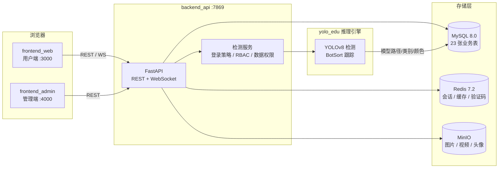

<div align="center">

# ClassAI-Edu

**基于深度学习的智慧课堂行为监测系统**

简体中文 | [English](README.en.md)

[](https://www.python.org/)
[](https://fastapi.tiangolo.com/)
[](https://nextjs.org/)
[](https://react.dev/)
[](https://docs.ultralytics.com/)
[](https://www.mysql.com/)
[](https://redis.io/)
[](https://min.io/)

</div>

---

## 项目简介

ClassAI-Edu 是一套端到端的课堂学生行为智能监测系统，覆盖 **数据采集 → 标注训练 → 实时检测 → 统计报表** 的完整链路。系统基于 YOLOv8 目标检测模型，能够自动识别课堂中的 6 类典型行为，并通过 WebSocket 实现毫秒级的实时视频流检测与多目标跟踪，为教学管理提供客观的量化数据支撑。

### 行为识别类别

| 类别 | 说明 |
| --- | --- |
| 试图抄袭（learning_to_copy） | 学生 A 观看学生 B 的答卷，B 不知情 |
| 分享答案（sharing_answers） | 学生 A 观看学生 B 的答卷，B 知情 |
| 东张西望（looking_around） | 视线长时间偏离课堂方向 |
| 睡觉（sleeping） | 趴桌、低头闭眼等状态 |
| 使用手机（using_mobile） | 使用电子设备 |
| 工作人员（staff） | 监考/工作人员 |

### 核心特性

- **实时检测与跟踪**：基于 WebSocket 的实时视频流推理，JSON 元数据帧 + JPEG 二进制帧交替传输；集成 BotSort 多目标跟踪，支持 RTSP / HTTP / USB 等多种视频源
- **离线检测任务**：图片批量检测、视频逐帧检测，结果结构化入库（检测明细、类别统计），可视化结果自动上传对象存储
- **模型配置全库化**：模型路径、类别定义、绘制样式（颜色/线宽/标签）全部由数据库驱动，支持多模型管理与一键导出（ONNX / CoreML / TorchScript）
- **完整管理后台**：基于 RBAC 的用户/角色/菜单权限管理、设备管理、公告通知、登录日志与在线用户监控
- **多样化登录**：账号密码（图形验证码）、GitHub OAuth、Google OAuth
- **训练指标可视化**：Precision / Recall / mAP / Loss 曲线与混淆矩阵动态展示，支持 ETag 缓存
- **国际化**：用户端与管理端均支持中/英双语切换

## 系统架构



## 项目结构

```
classai-edu/
├── backend_api/            # FastAPI 后端服务（端口 7869）
│   ├── routers/            # 15 个路由模块（REST + WebSocket）
│   ├── services/           # 业务服务 + 登录策略（password/GitHub/Google）
│   ├── repository/         # 数据访问层（手写 SQL + 连接池）
│   ├── auth/               # JWT 签发/校验 + 功能权限规则
│   ├── models/             # 统一响应体 + 操作日志切面 + 安全中间件
│   ├── schema/             # Pydantic 请求模型
│   ├── tools/              # DB/MinIO/数据权限/文件等工具
│   └── config/             # 环境配置 + 全局异常处理
├── frontend_web/           # 用户端（Next.js 16 + React 19）
├── frontend_admin/         # 管理端（Next.js 16 + React 19）
├── yolo_edu/               # AI 核心
│   ├── engines/            # 推理引擎 / 跟踪系统 / 模型导出
│   ├── services/           # 模型配置注册中心（数据库驱动）
│   ├── yolo_tools/         # 数据集工具链（划分/抽帧/增强/清洗）
│   ├── scripts/            # 训练指标导出（JSON + 曲线/混淆矩阵）
│   └── datasets/           # 6 类行为数据集（70/20/10 划分）
├── model/                  # 训练产物（n/s/m 三规格 + 多格式导出）
├── script/
│   ├── frp/                # 内网穿透配置（frp + nginx）
│   └── sql/                # 数据库初始化脚本
├── docker-compose.yml      # 一键部署（MySQL/Redis/MinIO/后端/双前端）
└── requirements.txt        # Python 依赖
```

## 模型性能

基于自建 6 类课堂行为数据集（训练集 2790 / 验证集 797 / 测试集 400），YOLOv8 三个规格对比实验后选用 **YOLOv8n** 部署：

| 指标 | 数值 |
| --- | --- |
| Precision | 0.829 |
| Recall | 0.795 |
| mAP@0.5 | 0.826 |
| 推理耗时 | ~123 ms（MPS） |

支持导出格式：**ONNX**、**CoreML**（mlpackage）、**TorchScript**。

## 快速开始

### 环境要求

- Python 3.11+
- Node.js 20+（推荐 22）
- Docker & Docker Compose（用于基础设施）
- MySQL 8.0 / Redis 7.2 / MinIO（可经 Docker 启动）

### 1. 启动基础设施

```bash
docker compose up -d mysql redis minio
# 仅启动基础设施：MySQL(3306) / Redis(6379) / MinIO(9000, 9001)
```

初始化数据库：

```bash
mysql -h 127.0.0.1 -uroot -p123456 < script/sql/classai_edu.sql
```

### 2. 配置后端

```bash
cd backend_api
cp .env.example .env   # 按实际环境修改连接信息
```

主要环境变量：

| 变量 | 说明 | 默认值 |
| --- | --- | --- |
| `MYSQL_HOST` / `MYSQL_PORT` | 数据库连接 | `127.0.0.1` / `3306` |
| `REDIS_HOST` / `REDIS_PORT` | 缓存连接 | `127.0.0.1` / `6379` |
| `MINIO_ADDRESS` / `MINIO_BUCKET_NAME` | 对象存储 | `127.0.0.1:9000` / `classai-edu` |
| `MINIO_ACCESS_KEY` / `MINIO_SECRET_KEY` | MinIO 凭据 | — |
| `JWT_SECRET_KEY` | JWT 签名密钥 | 建议生产环境务必修改 |
| `DASHBOARD_METRICS_DIR` | 训练指标目录 | `yolo_edu/scripts/metrics` |

### 3. 启动后端

```bash
pip install -r requirements.txt

python backend_api/classai_main.py
# 服务运行于 http://localhost:7869
```

### 4. 启动前端

```bash
# 用户端（端口 3000）
cd frontend_web
npm install
echo "NEXT_PUBLIC_BASE_URL=http://localhost:7869" > .env.local
npm run dev

# 管理端（端口 4000，另开终端）
cd frontend_admin
npm install
echo "NEXT_PUBLIC_BASE_URL=http://localhost:7869" > .env.local
npm run dev
```

访问地址：

| 服务 | 地址 |
| --- | --- |
| 用户端 | http://localhost:3000 |
| 管理端 | http://localhost:4000 |
| 后端 API | http://localhost:7869 |
| MinIO 控制台 | http://localhost:9001 |

## Docker 一键部署

生产环境一条命令拉起全部 6 个服务（MySQL / Redis / MinIO / 后端 / 用户端 / 管理端）：

```bash
# 1. 准备后端环境变量（首次）
cp backend_api/.env.example backend_api/.env.prod

# 2. 初始化数据库（仅首次）
docker compose up -d mysql
docker compose exec -T mysql mysql -uroot -p123456 classai_edu < script/sql/classai_edu.sql

# 3. 构建并启动全部服务
NEXT_PUBLIC_BASE_URL=http://<服务器IP>:7869 docker compose up -d --build
```

说明：
- `NEXT_PUBLIC_BASE_URL` 是**浏览器**访问后端的地址（构建期固化到前端），必须是外部可达的 IP 或域名，不能写容器名
- 容器内 MySQL / Redis / MinIO 地址会自动覆盖为服务名，`backend_api/.env.prod` 中的本机地址仅本地开发生效
- 各服务带健康检查，后端会等基础设施就绪后再启动

## 技术栈

| 层级 | 技术 |
| --- | --- |
| 后端 | FastAPI · SQLAlchemy（连接池）· PyMySQL · python-jose（JWT）· passlib（bcrypt） |
| AI | PyTorch · Ultralytics YOLOv8 · OpenCV · PyAV · SAHI（切片推理）· filterpy（跟踪） |
| 前端 | Next.js 16 · React 19 · TypeScript · Tailwind CSS 4 · framer-motion · recharts · i18next |
| 存储 | MySQL 8.0 · Redis 7.2 · MinIO |
| 部署 | Docker Compose · frp + nginx（可选内网穿透） |

## 路线图

- [ ] 流式视频检测结果落库（当前实时流仅预览）
- [ ] 学生个体级行为时序统计报表
- [ ] SAHI 小目标切片推理集成到在线服务
- [ ] data_scope 部门级数据权限（2/3/4）
- [ ] 单元测试与 CI 流水线

## 许可证

本项目暂未设置开源许可证，如需使用请联系作者。