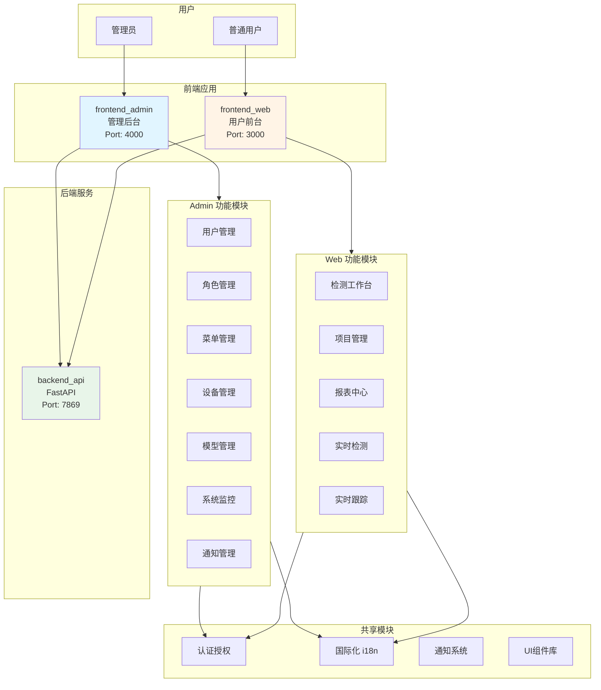

# 前端架构设计文档

## 1. 架构概览

本项目包含两个独立的前端应用，采用现代化的 Next.js App Router 架构：

```
┌─────────────────────────────────────────────────────────────┐
│                        ClassAI Edu                          │
├─────────────────────────────┬───────────────────────────────┤
│      frontend_admin         │        frontend_web           │
│    (管理后台 - Port 4000)    │     (用户前台 - Port 3000)    │
└─────────────────────────────┴───────────────────────────────┘
```

---

## 2. 技术栈

### 2.1 核心框架

| 技术 | frontend_admin | frontend_web |
|------|---------------|--------------|
| **Next.js** | 16.1.2 | 16.0.3 |
| **React** | 19.2.3 | 19.2.0 |
| **TypeScript** | 5.x | 5.x |
| **Tailwind CSS** | 4.x | 4.x |

### 2.2 状态管理与数据交互

| 技术 | 用途 |
|------|------|
| **Axios** | HTTP 客户端 |
| **Context API** | 全局状态管理 |
| **React Hooks** | 组件状态逻辑复用 |
| **js-cookie** | Token 管理 |
| **i18next** | 国际化方案 |

### 2.3 UI与动画库

| 技术 | 用途 |
|------|------|
| **Framer Motion** | 动画引擎 |
| **GSAP** | 高级动画（仅 Admin） |
| **Lucide React** | 图标库 |
| **Recharts** | 图表库（仅 Web） |
| **class-variance-authority** | CSS类变体管理 |
| **clsx** | 类名合并（仅 Web） |

---

## 3. 项目结构对比

### 3.1 frontend_admin (管理后台)

```
frontend_admin/
├── app/                          # Next.js App Router
│   ├── layout.tsx                # 根布局（Provider注入）
│   ├── page.tsx                  # 首页
│   ├── identity/                 # 登录注册页面
│   ├── auth/callback/            # OAuth回调
│   └── admin/                    # 管理后台主应用
│       ├── layout.tsx            # AdminLayout包装
│       ├── dashboard/            # 仪表盘
│       ├── users/                # 用户管理
│       ├── roles/                # 角色管理
│       ├── menus/                # 菜单管理
│       ├── banners/              # 轮播图管理
│       ├── devices/              # 设备管理
│       ├── models/               # 模型管理
│       ├── profile/              # 个人中心
│       ├── change-password/      # 修改密码
│       └── settings/             # 系统设置
│           ├── page.tsx          # 设置首页
│           ├── monitor/          # 系统监控
│           └── notices/          # 通知管理
│
├── components/                   # 组件库
│   ├── AdminLayout.tsx           # 后台主布局
│   ├── Sidebar.tsx               # 侧边栏导航
│   ├── LanguageSwitcher.tsx      # 语言切换器
│   ├── IdentityPage.tsx          # 登录注册组件
│   ├── UsersPage.tsx             # 用户管理组件
│   ├── RolesPage.tsx             # 角色管理组件
│   ├── MenusPage.tsx             # 菜单管理组件
│   ├── BannersPage.tsx           # 轮播图管理
│   ├── DevicesPage.tsx           # 设备管理
│   ├── ModelsPage.tsx            # 模型管理
│   ├── DrawConfigModal.tsx       # 绘图配置弹窗
│   ├── VideoSourceSelector.tsx   # 视频源选择器
│   ├── DashboardPage.tsx         # 仪表盘组件
│   ├── ProfilePage.tsx           # 个人中心
│   ├── ChangePasswordPage.tsx    # 修改密码
│   ├── SettingsPage.tsx          # 系统设置
│   ├── MonitorPage.tsx           # 系统监控
│   ├── NoticesPage.tsx           # 通知管理
│   ├── ClientOnly.tsx            # 客户端渲染包装
│   ├── StatCard.tsx              # 统计卡片
│   └── ui/                       # UI基础组件
│       ├── table.tsx
│       ├── modal.tsx
│       ├── dropdown.tsx
│       ├── select.tsx
│       ├── tabs.tsx
│       ├── badge.tsx
│       └── form/Field.tsx
│
├── lib/                          # 核心库
│   ├── api.ts                    # Axios客户端封装
│   ├── contexts/                 # Context定义
│   │   └── PermissionsContext.tsx
│   └── service/                  # API服务层
│       ├── identity.ts           # 认证服务
│       ├── user.ts               # 用户服务
│       ├── role.ts               # 角色服务
│       ├── menu.ts               # 菜单服务
│       ├── notice.ts             # 通知服务
│       ├── device.ts             # 设备服务
│       ├── model.ts              # 模型服务
│       ├── model_class.ts        # 模型类别
│       ├── model_draw_config.ts  # 绘图配置
│       ├── banner.ts             # 轮播图
│       ├── dashboard.ts          # 仪表盘
│       ├── detectionTask.ts      # 检测任务
│       ├── detectionDetail.ts    # 检测详情
│       ├── monitor.ts            # 系统监控
│       └── config.ts             # 系统配置
│
├── contexts/                     # React Context
│   ├── I18nProvider.tsx          # 国际化Provider
│   └── LanguageContext.tsx       # 语言上下文
│
├── hooks/                        # 自定义Hooks（暂无）
│
├── i18n/                         # 国际化配置
│   ├── index.ts
│   └── locales/                  # 语言包
│       ├── en/                   # 英语
│       └── zh/                   # 中文
│
├── utils/                        # 工具函数
│   ├── cn.ts                     # 类名合并
│   ├── notification.tsx          # 通知组件
│   └── confirm.tsx               # 确认对话框
│
├── enums/                        # 枚举定义
│
├── public/                       # 静态资源
│
├── middleware.ts                 # 路由守卫中间件
├── .env                          # 环境变量
└── package.json
```

### 3.2 frontend_web (用户前台)

```
frontend_web/
├── app/                          # Next.js App Router
│   ├── layout.tsx                # 根布局（Provider注入）
│   ├── page.tsx                  # 首页
│   ├── identity/                 # 登录注册页面
│   ├── auth/callback/            # OAuth回调
│   ├── dashboard/                # 仪表盘
│   ├── detection/                # 检测工作区
│   │   ├── page.tsx              # 检测主页
│   │   ├── predict/              # 预测页面
│   │   └── track/                # 跟踪页面
│   ├── projects/                 # 项目管理
│   ├── reports/                  # 报表中心
│   ├── profile/                  # 个人中心
│   └── change-password/          # 修改密码
│
├── components/                   # 组件库
│   ├── Navigation.tsx            # 顶部导航栏
│   ├── LanguageSwitcher.tsx      # 语言切换器
│   ├── HomePage.tsx              # 首页组件
│   ├── IdentityPage.tsx          # 登录注册组件
│   ├── DashboardPage.tsx         # 仪表盘组件
│   ├── PredictPage.tsx           # 预测页面
│   ├── PredictWorkbench.tsx      # 预测工作台
│   ├── TrackPage.tsx             # 跟踪页面
│   ├── TrackWorkbench.tsx        # 跟踪工作台
│   ├── ProjectsPage.tsx          # 项目管理
│   ├── ReportsPage.tsx           # 报表中心
│   ├── ProfilePage.tsx           # 个人中心
│   ├── ChangePasswordPage.tsx    # 修改密码
│   ├── DetectionWorkspace.tsx    # 检测工作区
│   ├── DeviceModelSettingModal.tsx  # 设备模型设置
│   ├── ClientOnly.tsx            # 客户端渲染包装
│   ├── detection/                # 检测相关组件
│   └── ui/                       # UI基础组件
│       ├── button.tsx
│       ├── input.tsx
│       ├── table.tsx
│       ├── modal.tsx
│       ├── dropdown.tsx
│       ├── select.tsx
│       ├── badge.tsx
│       ├── card.tsx
│       ├── form/Field.tsx
│       ├── blur-text.tsx         # 模糊文本动画
│       ├── gradient-text.tsx     # 渐变文本
│       ├── typewriter-text.tsx   # 打字机效果
│       ├── count-up.tsx          # 数字递增动画
│       ├── magnetic-button.tsx   # 磁性按钮
│       ├── spotlight-card.tsx    # 聚光灯卡片
│       ├── magic-bento.tsx       # Bento布局
│       ├── aurora-background.tsx # 极光背景
│       ├── animated-content.tsx  # 动画内容
│       ├── subtle-particles.tsx  # 细腻粒子
│       └── floating-particles.tsx # 浮动粒子
│
├── lib/                          # 核心库
│   ├── api.ts                    # Axios客户端封装
│   └── service/                  # API服务层
│       ├── identity.ts           # 认证服务
│       ├── user.ts               # 用户服务
│       ├── device.ts             # 设备服务
│       ├── model_config.ts       # 模型配置
│       ├── banner.ts             # 轮播图
│       ├── dashboard.ts          # 仪表盘
│       ├── detection_task.ts     # 检测任务
│       ├── notice.ts             # 通知服务
│       └── report.ts             # 报表服务
│
├── contexts/                     # React Context
│   ├── I18nProvider.tsx          # 国际化Provider
│   └── LanguageContext.tsx       # 语言上下文
│
├── hooks/                        # 自定义Hooks
│   ├── useWebSocket.ts           # WebSocket连接
│   └── useCameraStream.ts        # 摄像头流
│
├── i18n/                         # 国际化配置
│   ├── index.ts
│   └── locales/                  # 语言包
│       ├── en/                   # 英语
│       └── zh/                   # 中文
│
├── utils/                        # 工具函数
│   ├── cn.ts                     # 类名合并
│   ├── notification.tsx          # 通知组件
│   ├── confirm.tsx               # 确认对话框
│   └── buildParams.ts            # 参数构建
│
├── enums/                        # 枚举定义
│
├── public/                       # 静态资源
│   └── metrics/                  # 指标图标
│
├── middleware.ts                 # 路由守卫中间件
├── .env                          # 环境变量
└── package.json
```

---

## 4. 核心架构设计

### 4.1 路由架构

#### 4.1.1 frontend_admin 路由结构

```
/ (公开)
├── identity                      # 登录/注册页面
├── auth/callback                 # OAuth回调
└── admin/ (需认证)               # 管理后台
    ├── dashboard                 # 仪表盘
    ├── users                     # 用户管理
    ├── roles                     # 角色管理
    ├── menus                     # 菜单管理
    ├── banners                   # 轮播图管理
    ├── devices                   # 设备管理
    ├── models                    # 模型管理
    ├── profile                   # 个人中心
    ├── change-password           # 修改密码
    └── settings/                 # 系统设置
        ├── monitor               # 系统监控
        └── notices               # 通知管理
```

#### 4.1.2 frontend_web 路由结构

```
/ (公开)
├── identity                      # 登录/注册页面
├── auth/callback                 # OAuth回调
└── (需认证)
    ├── dashboard                 # 仪表盘
    ├── detection/                # 检测工作区
    │   ├── predict               # 预测页面
    │   └── track                 # 跟踪页面
    ├── projects                  # 项目管理
    ├── reports                   # 报表中心
    ├── profile                   # 个人中心
    └── change-password           # 修改密码
```

### 4.2 中间件路由守卫

两个前端应用均采用 Next.js Middleware 实现路由保护：

```typescript
// middleware.ts 核心逻辑
export function middleware(request: NextRequest) {
  const token = request.cookies.get('AUTH_TOKEN');
  const { pathname } = request.nextUrl;

  // 受保护路径列表
  const protectedPaths = ['/admin/*', '/dashboard', '/detection', ...];

  // 公开路径列表
  const publicPaths = ['/', '/identity', '/auth/callback'];

  // 未授权访问受保护页面 → 重定向到登录页
  if (isProtectedPath && !token) {
    return NextResponse.redirect(loginUrl);
  }

  // 已登录访问登录页 → 重定向到主页面
  if (token && pathname === '/identity') {
    return NextResponse.redirect(dashboardUrl);
  }
}
```

---

## 5. 状态管理架构

### 5.1 Context 层级结构

```tsx
// frontend_admin - 根布局
<html>
  <ClientOnly>
    <I18nProvider>              {/* 国际化 */}
      <LanguageProvider>        {/* 语言状态 */}
        <PermissionsProvider>   {/* 权限管理 */}
          {children}
          <NotificationContainer />
          <ConfirmContainer />
        </PermissionsProvider>
      </LanguageProvider>
    </I18nProvider>
  </ClientOnly>
</html>

// frontend_web - 根布局
<html>
  <ClientOnly>
    <I18nProvider>              {/* 国际化 */}
      <LanguageProvider>        {/* 语言状态 */}
        {children}
        <NotificationContainer />
        <ConfirmContainer />
      </LanguageProvider>
    </I18nProvider>
  </ClientOnly>
</html>
```

### 5.2 全局状态说明

| Context | 用途 | 使用场景 |
|---------|------|----------|
| **I18nProvider** | 国际化配置管理 | 提供多语言支持 |
| **LanguageProvider** | 当前语言状态 | 语言切换、语言持久化 |
| **PermissionsProvider** | 用户权限管理 | 菜单权限控制（仅Admin） |

---

## 6. 网络请求架构

### 6.1 ApiClient 封装

```typescript
class ApiClient {
  private instance: AxiosInstance;

  constructor(baseURL: string) {
    this.instance = axios.create({
      baseURL,
      headers: { 'Content-Type': 'application/json' },
      withCredentials: false,
    });

    // 请求拦截器：自动注入Token
    this.instance.interceptors.request.use((config) => {
      const token = Cookies.get('AUTH_TOKEN');
      if (token) {
        config.headers.Authorization = `Bearer ${token}`;
      }
      return config;
    });

    // 响应拦截器：统一错误处理
    this.instance.interceptors.response.use(
      (response) => response.data,
      (error) => {
        if (error.response?.status === 401) {
          notification.error('Please login first');
        }
        return Promise.reject(error);
      }
    );
  }
}
```

### 6.2 Service 层设计

Service 层采用**模块化设计**，每个业务领域独立封装：

#### frontend_admin Service 模块（17个）

```
├── identity.ts          # 登录/注册/用户信息
├── user.ts              # 用户CRUD
├── role.ts              # 角色CRUD
├── menu.ts              # 菜单CRUD + 权限树
├── notice.ts            # 通知CRUD + 已读状态
├── device.ts            # 设备CRUD + 状态管理
├── model.ts             # 模型CRUD + 配置
├── model_class.ts       # 模型类别
├── model_draw_config.ts # 绘图配置
├── banner.ts            # 轮播图管理
├── dashboard.ts         # 仪表盘数据
├── detectionTask.ts     # 检测任务
├── detectionDetail.ts   # 检测详情
├── monitor.ts           # 系统监控数据
└── config.ts            # 系统配置
```

#### frontend_web Service 模块（9个）

```
├── identity.ts          # 登录/注册/用户信息
├── user.ts              # 用户信息
├── device.ts            # 设备管理
├── model_config.ts      # 模型配置
├── banner.ts            # 轮播图
├── dashboard.ts         # 仪表盘数据
├── detection_task.ts    # 检测任务
├── notice.ts            # 通知服务
└── report.ts            # 报表数据
```

---

## 7. 国际化架构

### 7.1 i18n 配置

两个前端应用均已完整实现国际化支持：

```typescript
// i18n/index.ts
import i18n from 'i18next';
import { initReactI18next } from 'react-i18next';

i18n
  .use(initReactI18next)
  .init({
    resources: {
      en: { translation: require('./locales/en/common.json') },
      zh: { translation: require('./locales/zh/common.json') },
    },
    lng: 'zh',              // 默认语言
    fallbackLng: 'en',      // 回退语言
    interpolation: {
      escapeValue: false,
    },
  });
```

### 7.2 语言切换实现

```tsx
// LanguageSwitcher.tsx
export function LanguageSwitcher() {
  const { i18n } = useTranslation();
  const { language, setLanguage } = useLanguage();

  const toggleLanguage = () => {
    const newLang = language === 'zh' ? 'en' : 'zh';
    setLanguage(newLang);
    i18n.changeLanguage(newLang);
  };

  return (
    <button onClick={toggleLanguage}>
      {language === 'zh' ? 'English' : '中文'}
    </button>
  );
}
```

### 7.3 使用示例

```tsx
import { useTranslation } from 'react-i18next';

function MyComponent() {
  const { t } = useTranslation();

  return (
    <div>
      <h1>{t('dashboard.title')}</h1>
      <p>{t('dashboard.welcome', { name: 'User' })}</p>
    </div>
  );
}
```

---

## 8. 布局架构对比

### 8.1 frontend_admin - 侧边栏布局

```
┌──────────────────────────────────────────────────┐
│  Header (Logo + Search + Notifications + User)   │
├────────┬─────────────────────────────────────────┤
│        │                                         │
│  Side  │                                         │
│  bar   │          Main Content Area              │
│        │                                         │
│  - Nav │      (AdminLayout + Page Component)     │
│  - Menu│                                         │
│  - Item│                                         │
│        │                                         │
└────────┴─────────────────────────────────────────┘
```

**核心组件：**
- `AdminLayout.tsx`: 主布局容器，管理Header和Sidebar
- `Sidebar.tsx`: 可折叠侧边栏，动态菜单渲染
- `Dropdown`: 用户菜单、通知下拉

### 8.2 frontend_web - 顶部导航布局

```
┌──────────────────────────────────────────────────┐
│  Navigation (Logo + Menu + Notifications + User) │
├──────────────────────────────────────────────────┤
│                                                  │
│                                                  │
│              Main Content Area                   │
│                                                  │
│          (Page Component)                        │
│                                                  │
│                                                  │
└────────────��─────────────────────────────────────┘
```

**核心组件：**
- `Navigation.tsx`: 顶部导航栏，固定在页面顶部
- 简洁的单层导航结构
- 更大的内容展示区域

---

## 9. UI 组件库设计

### 9.1 基础组件（共用）

| 组件 | 文件 | 用途 |
|------|------|------|
| **Button** | button.tsx | 按钮组件 |
| **Input** | input.tsx | 输入框 |
| **Select** | select.tsx | 下拉选择 |
| **Modal** | modal.tsx | 模态框 |
| **Dropdown** | dropdown.tsx | 下拉菜单 |
| **Table** | table.tsx | 表格 |
| **Badge** | badge.tsx | 徽章 |
| **Tabs** | tabs.tsx | 标签页 |
| **Field** | form/Field.tsx | 表单字段 |

### 9.2 frontend_admin 特有组件

```
├── StatCard.tsx           # 统计卡片
├── VideoSourceSelector.tsx # 视频源选择器
└── DrawConfigModal.tsx    # 绘图配置弹窗
```

### 9.3 frontend_web 特有组件（特效动画）

```
├── blur-text.tsx          # 模糊文本动画
├── gradient-text.tsx      # 渐变文本
├── typewriter-text.tsx    # 打字机效果
├── count-up.tsx           # 数字递增动画
├── magnetic-button.tsx    # 磁性按钮
├── spotlight-card.tsx     # 聚光灯卡片
├── magic-bento.tsx        # Bento布局
├── aurora-background.tsx  # 极光背景
├── animated-content.tsx   # 动画内容
├── subtle-particles.tsx   # 细腻粒子
└── floating-particles.tsx # 浮动粒子
```

**设计理念：**
- **Admin**: 注重功能性、数据密集型界面
- **Web**: 注重视觉效果、动画交互、用户体验

---

## 10. 自定义 Hooks（frontend_web）

### 10.1 useWebSocket

```typescript
// 实时WebSocket连接管理
export function useWebSocket(url: string) {
  const [socket, setSocket] = useState<WebSocket | null>(null);
  const [isConnected, setIsConnected] = useState(false);

  useEffect(() => {
    const ws = new WebSocket(url);
    ws.onopen = () => setIsConnected(true);
    ws.onclose = () => setIsConnected(false);
    setSocket(ws);

    return () => ws.close();
  }, [url]);

  const sendMessage = (data: any) => {
    if (socket && isConnected) {
      socket.send(JSON.stringify(data));
    }
  };

  return { socket, isConnected, sendMessage };
}
```

**使用场景：** 实时视频流检测、实时数据推送

### 10.2 useCameraStream

```typescript
// 摄像头流管理
export function useCameraStream(deviceId?: string) {
  const [stream, setStream] = useState<MediaStream | null>(null);
  const [error, setError] = useState<string | null>(null);

  useEffect(() => {
    navigator.mediaDevices.getUserMedia({
      video: deviceId ? { deviceId } : true,
      audio: false,
    })
    .then(setStream)
    .catch((err) => setError(err.message));
  }, [deviceId]);

  const stopStream = () => {
    stream?.getTracks().forEach(track => track.stop());
  };

  return { stream, error, stopStream };
}
```

**使用场景：** 实时摄像头检测、视频流捕获

---

## 11. 认证与授权流程

### 11.1 登录流程

```
┌─────────┐                    ┌──────────┐                 ┌──────────┐
│  User   │                    │  Frontend│                 │  Backend │
└────┬────┘                    └────┬─────┘                 └────┬─────┘
     │  1. 输入账号密码              │                             │
     │──────────────────────>│                             │
     │                       │  2. POST /identity/login    │
     │                       │────────────────────────────>│
     │                       │                             │
     │                       │  3. 返回 JWT Token          │
     │                       │<────────────────────────────│
     │                       │                             │
     │                       │  4. 存储到 Cookie           │
     │                       │  (AUTH_TOKEN)               │
     │                       │                             │
     │  5. 跳转到 Dashboard   │                             │
     │<──────────────────────│                             │
```

### 11.2 OAuth 登录流程

```
┌─────────┐                    ┌──────────┐                 ┌──────────┐
│  User   │                    │  Frontend│                 │  Backend │
└────┬────┘                    └────┬─────┘                 └────┬─────┘
     │  1. 点击 Google/GitHub     │                             │
     │──────────────────────>│                             │
     │                       │  2. 重定向到 OAuth Provider │
     │<──────────────────────│                             │
     │                       │                             │
     │  3. 用户授权           │                             │
     │─��────────────────────>│                             │
     │                       │                             │
     │  4. 回调到 /auth/callback│                            │
     │<──────────────────────│                             │
     │                       │  5. 发送 code 到后端         │
     │                       │────────────────────────────>│
     │                       │                             │
     │                       │  6. 返回 JWT Token          │
     │                       │<────────────────────────────│
```

### 11.3 Token 管理

```typescript
// 登录成功后存储Token
Cookies.set('AUTH_TOKEN', token, { expires: 7 }); // 7天有效期

// 退出登录清除Token
Cookies.remove('AUTH_TOKEN');

// 请求时自动注入Token（通过Api拦截器）
config.headers.Authorization = `Bearer ${token}`;
```

---

## 12. 权限管理（frontend_admin）

### 12.1 权限架构

```typescript
// PermissionsContext.tsx
export function PermissionsProvider({ children }) {
  const [permissions, setPermissions] = useState<string[]>([]);
  const [menus, setMenus] = useState<Menu[]>([]);

  useEffect(() => {
    // 加载用户菜单和权限
    MenuService.getMenusByUserId().then((data) => {
      setMenus(data.menus);
      setPermissions(data.permissions);
    });
  }, []);

  const hasPermission = (permission: string) => {
    return permissions.includes(permission);
  };

  return (
    <PermissionsContext.Provider value={{ permissions, menus, hasPermission }}>
      {children}
    </PermissionsContext.Provider>
  );
}
```

### 12.2 菜单权限控制

```tsx
// Sidebar.tsx 动态渲染菜单
const menuItems = menus
  .filter(menu => hasPermission(menu.permission))
  .map(menu => (
    <MenuItem key={menu.id} href={menu.path}>
      {menu.name}
    </MenuItem>
  ));
```

---

## 13. 通知与确认对话框

### 13.1 Notification 组件

```tsx
// 使用示例
import { notification } from '@/utils/notification';

// 成功通知
notification.success('Operation successful!');

// 错误通知
notification.error('Operation failed!');

// 警告通知
notification.warning('Please check your input!');
```

### 13.2 Confirm 组件

```tsx
// 使用示例
import { confirm } from '@/utils/confirm';

const result = await confirm({
  title: 'Confirm Delete',
  message: 'Are you sure you want to delete this item?',
  confirmText: 'Delete',
  cancelText: 'Cancel',
});

if (result) {
  // 用户��认删除
  handleDelete();
}
```

---

## 14. 环境变量配置

### 14.1 .env 文件

```env
# backend_api 地址（两个前端共用）
NEXT_PUBLIC_API_URL=http://localhost:7869
```

### 14.2 API Base URL

```typescript
// lib/api.ts
const API_BASE_URL = process.env.NEXT_PUBLIC_API_URL || 'http://localhost:7869';

export const apiClient = new ApiClient(API_BASE_URL);
```

---

## 15. 构建与部署

### 15.1 开发环境

```bash
# frontend_admin
cd frontend_admin
npm run dev  # 启动在 http://localhost:4000

# frontend_web
cd frontend_web
npm run dev  # 启动在 http://localhost:3000
```

### 15.2 生产构建

```bash
# 构建
npm run build

# 启动生产服务器
npm start
```

### 15.3 Docker 部署（推荐）

```dockerfile
# 示例 Dockerfile
FROM node:20-alpine

WORKDIR /app

COPY package*.json ./
RUN npm ci --only=production

COPY docs .
RUN npm run build

EXPOSE 3000
CMD ["npm", "start"]
```

---

## 16. 性能优化策略

### 16.1 代码分割

- 使用 Next.js 动态导入：`dynamic(() => import('Component'))`
- 路由级别自动分割
- 第三方库按需加载

### 16.2 图片优化

- 使用 Next.js `<Image>` 组件
- 自动 WebP 转换
- 响应式图片加载

### 16.3 缓存策略

- 静态资源 CDN 缓存
- API 响应合理使用 Redis 缓存
- Service Worker（可选）

---

## 17. 安全策略

### 17.1 XSS 防护

- React 自动转义
- 避免使用 `dangerouslySetInnerHTML`
- CSP (Content Security Policy) 配置

### 17.2 CSRF 防护

- Token 存储在 HttpOnly Cookie（推荐）
- 或使用 CSRF Token 验证

### 17.3 敏感信息保护

- 环境变量管理密钥
- 不在前端存储敏感数据
- API 响应过滤敏感字段

---

## 18. 国际化完成状态

### ✅ 已完成

两个前端应用（frontend_admin 和 frontend_web）的国际化功能**已全部完成**，包括：

- ✅ i18next 配置与集成
- ✅ 中英文语言包完整翻译
- ✅ 所有页面组件国际化支持
- ✅ 语言切换器功能
- ✅ 语言持久化（localStorage）
- ✅ 默认语言设置（中文）

---

## 19. 总结

### 19.1 frontend_admin 特点

- **定位：** 管理后台，面向管理员
- **布局：** 侧边栏 + 主内容区
- **功能：** 用户管理、角色权限、系统配置、监控
- **特点：** 数据密集、功能完善、权限控制严格
- **端口：** 4000

### 19.2 frontend_web 特点

- **定位：** 用户前台，面向普通用户
- **布局：** 顶部导航 + 主内容区
- **功能：** 检测工作台、项目管理、报表查看
- **特点：** 视觉效果丰富、动画交互流畅、用户体验优秀
- **端口：** 3000

### 19.3 共同特点

- Next.js 16 + React 19 最新技术栈
- TypeScript 类型安全
- Tailwind CSS 4 现代化样式
- 完整的国际化支持
- 统一的 API 请求架构
- 模块化的组件设计
- 路由守卫与权限控制

---

## 20. 架构图

### 20.1 整体架构图



### 20.2 技术栈架构图

```mermaid
graph LR
    subgraph Frontend_Layer["前端层"]
        NEXT[Next.js 16<br/>App Router]
        REACT[React 19]
        TS[TypeScript 5]
        TW[Tailwind CSS 4]
    end

    subgraph State_Mgmt["状态管理"]
        CONTEXT[Context API]
        HOOKS[Custom Hooks]
    end

    subgraph Network["网络请求"]
        AXIOS[Axios]
        WS[WebSocket]
    subgraph I18n["国际化"]
        I18NEXT[i18next]
        REACT_I18N[react-i18next]
    end

    subgraph UI_Lib["UI组件库"]
        FRAMER[Framer Motion]
        LUCIDE[Lucide Icons]
        RECHARTS[Recharts]
    end

    NEXT --> REACT
    REACT --> TS
    TS --> TW

    REACT --> CONTEXT
    REACT --> HOOKS

    NEXT --> AXIOS
    NEXT --> WS

    REACT --> I18NEXT
    I18NEXT --> REACT_I18N

    REACT --> FRAMER
    REACT --> LUCIDE
    REACT --> RECHARTS

    style NEXT fill:#e1f5ff
    style REACT fill:#fff4e6
    style CONTEXT fill:#e8f5e9
```

---

**文档版本：** v1.0
**最后更新：** 2026-03-20
**维护者：** ClassAI Edu Team